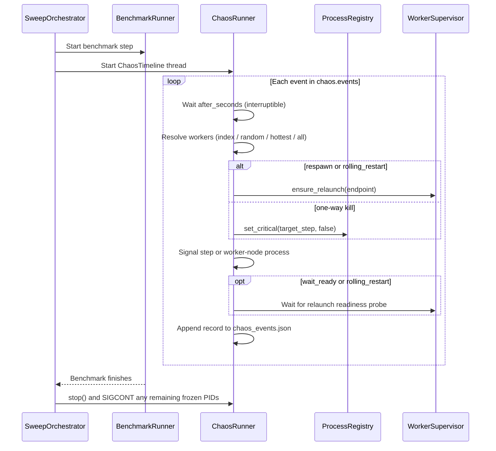

# Chaos Fault Injection

The top-level `chaos:` block schedules worker and process faults concurrently while a benchmark runs, recording exact UTC timestamps, resolved targets, and verification state to `logs/chaos_events.json`.

Fields: [ChaosConfig](schema-reference.md#chaosconfig), [ChaosEventConfig](schema-reference.md#chaoseventconfig), and [ChaosScheduleConfig](schema-reference.md#chaosscheduleconfig).

## How It Works



### Worker Fault Tolerance and Restart Semantics

- **Per-target `critical` scoping:** On `kill` when `respawn: false` and `roles.<role>.restart` is `never`, `ChaosRunner` marks only the targeted worker's step(s) non-critical (`ProcessRegistry.set_critical(name, False)`) right before signalling. Surviving workers keep `critical: true`, so unintended collateral crashes still fail the job. A worker under `roles.<role>.restart` stays critical: the supervisor relaunches it, and once its restart budget is exhausted the exit fails the job as usual.
- **Supervisor-backed relaunch:** When `roles.<role>.restart` is enabled, or when an event sets `respawn: true` or uses `rolling_restart`, exits are handled by the existing `WorkerSupervisor` (`worker_restarts.json`, log rotation to `<log>.out.<n>`, `_r<n>` step naming, and `/health` readiness probing). Setting `wait_ready: true` on `kill` waits for the relaunched worker's `/health` probe before starting the next event.

## Event Types

- `kill`: signals the target worker step(s) through the launcher (`scancel --signal=<sig> --full <job>.<step>` under Slurm). When `process:` is set, runs an overlapping bare-host helper on every node of the worker to list matching subprocesses (scoped by the worker step's `SLURM_STEP_ID`; a cmdline-only match is used only when no other worker shares the node), picks `rank` (`0`, `1`, ..., `random`, or `all`) from the combined list ordered by node then PID, and sends `signal` to those PIDs. If nothing matches, the event fails before the worker is touched.
- `freeze`: sends `SIGSTOP` to the matched subprocess rank(s) (defaults to `process: engine`), polls `/proc/<pid>/stat` until state `T` is verified, holds for `duration_seconds` (or, without one, until benchmark teardown even after the timeline has run out of events), then sends `SIGCONT` and verifies state is no longer `T`. Every target is resolved before anything is paused; if a pause fails partway, the processes already paused are resumed at once. Any paused process is unconditionally resumed on teardown.
- `rolling_restart`: restarts every worker of `role` in a sliding window capped at `max_unavailable`, waiting for each replacement to pass its readiness probe through `WorkerSupervisor` before taking down the next worker. If a replacement fails its readiness probe or cannot be relaunched, the event stops with `status: "failed"` instead of taking down another worker.

### Worker Selection (`workers:`)

- `0` or `[0, 1]` — zero-based worker index(es) within `role`.
- `random` or `random:<N>` — picks `N` workers uniformly at random (deterministic when `chaos.seed` is set).
- `all` — targets every worker of `role`.
- `hottest` or `hottest:<N>` — scrapes `chaos.hot_metric` (default `dynamo_component_inflight_requests`, falling back to engine running-request gauges) from each worker's Prometheus endpoint (under `dynamo.sidecar`, both the sidecar runtime and the native engine listeners) and picks the `N` busiest workers. If no worker reports a positive value, falls back to index order and records `fallback: true`.

### Engine Process Targets (`process:`)

`kill` (when `process:` is set) and `freeze` resolve semantic aliases through the role backend's `fault_process_targets`:

| Engine | `main` | `engine` | `rank` |
| --- | --- | --- | --- |
| `vllm` | `dynamo.vllm` | `VLLM::EngineCore` | `VLLM::Worker` |
| `sglang` | `dynamo.sglang` | `sglang::scheduler` | `sglang::scheduler` |
| `trtllm` | `dynamo.trtllm` | `tensorrt_llm.llmapi.mgmn_worker_node` | `tensorrt_llm.llmapi.mgmn_worker_node` |
| `mocker` | `dynamo.mocker` | `dynamo.mocker` | `dynamo.mocker` |

`main` names the Dynamo worker module, so it is rejected for native workers (a frontend that launches the engine directly, or `dynamo.sidecar`); use a literal substring there. Any other string in `process:` is matched verbatim as a cmdline substring (e.g. `process: "sglang::detokenizer"`), which also works for engines without default aliases.

### Safety Guards and Soak Schedules

- **`leashed: true` (live dry-run):** runs target selection, Prometheus `hottest` scraping, `min_healthy` checks, and on-node process discovery without sending any signal. Events are recorded in `chaos_events.json` with `status: "leashed"`.
- **`min_healthy: N` (blast-radius guard):** refuses to fire a `kill` or `freeze` when fewer than `min_healthy` healthy workers of `role` would remain (recording `status: "skipped"` with `reason: "min_healthy_guard"`), and throttles `rolling_restart` waves so at least `min_healthy` workers stay up.
- **`schedule:` (stochastic soak mode):** repeatedly injects `kill` or `freeze` faults until the benchmark exits (or `max_events` is reached), drawing inter-event delays with mean `mean_interval_seconds` and floor `min_interval_seconds` (`min + Exp(1 / (mean - min))`). `initial_delay_seconds` counts from benchmark start, so scripted `events` do not push the first soak fault back.
- **No nsys:** a recipe with `chaos:` cannot enable nsys (`observability.nsys` or `profiling.type: nsys`/`nsys-time`). Killed, frozen, or relaunched workers leave reports unfinalized, miss capture-boundary acknowledgments (which hangs the benchmark), and reuse report paths. Set `observability.nsys.enabled: false` and leave `profiling.type: none` (the default).

## Example

See [examples/features/chaos.yaml](https://github.com/NVIDIA/srt-slurm/blob/main/examples/features/chaos.yaml) (mocker) and [examples/features/dynamo-fault-tolerance.yaml](https://github.com/NVIDIA/srt-slurm/blob/main/examples/features/dynamo-fault-tolerance.yaml) (SGLang + Dynamo KV routing + request migration + worker restart) for runnable recipes, or combine `chaos:` with [Config Overrides](overrides.md) (`base:` + `override_*`) to compare a clean baseline against fault variants from one file.

```yaml
schema: 2
name: "qwen3-0.6b-chaos-example"

model:
  path: "qwen3-0.6b"
  container: "sglang"
  precision: "bf16"

resources:
  gpu_type: "h100"
  gpus_per_node: 8

frontend:
  type: dynamo

engine:
  type: mocker

roles:
  agg:
    nodes: 1
    workers: 2
    restart: on-failure

benchmark:
  type: "sa-bench"
  isl: 128
  osl: 128
  concurrencies: "8"

chaos:
  min_healthy: 1
  leashed: false
  seed: 7
  events:
    - after_seconds: 30
      type: kill
      role: agg
      workers: hottest
      respawn: true
      wait_ready: true
  schedule:
    initial_delay_seconds: 60
    mean_interval_seconds: 180
    min_interval_seconds: 90
    max_events: 4
    type: kill
    role: agg
    workers: random
    respawn: true
```
