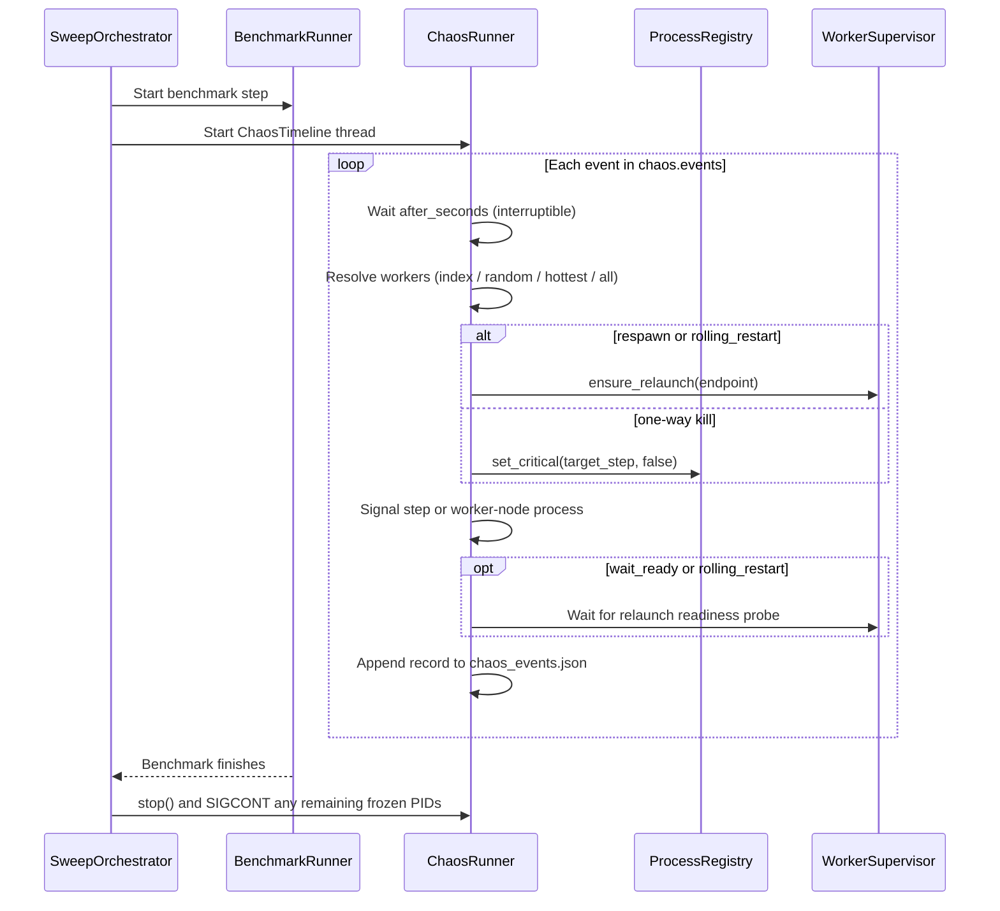

# Chaos Fault Injection

The top-level `chaos:` block schedules worker and process faults concurrently while a benchmark runs, recording exact UTC timestamps, resolved targets, and verification state to `logs/chaos_events.json`.

Fields: [ChaosConfig](schema-reference.md#chaosconfig) and [ChaosEventConfig](schema-reference.md#chaoseventconfig).

## How It Works



### Worker Fault Tolerance and Restart Semantics

- **Per-target `critical` scoping:** On `kill` when `respawn: false` and `roles.<role>.restart` is `never`, `ChaosRunner` marks only the targeted worker's step(s) non-critical (`ProcessRegistry.set_critical(name, False)`) right before signalling. Surviving workers keep `critical: true`, so unintended collateral crashes still fail the job.
- **Supervisor-backed relaunch:** When `roles.<role>.restart` is enabled, or when an event sets `respawn: true` or uses `rolling_restart`, exits are handled by the existing `WorkerSupervisor` (`worker_restarts.json`, log rotation to `<log>.out.<n>`, `_r<n>` step naming, and `/health` readiness probing). Setting `wait_ready: true` on `kill` waits for the relaunched worker's `/health` probe before starting the next event.

## Event Types

- `kill`: signals the target worker step(s) through the launcher (`scancel --signal=<sig> --full <job>.<step>` under Slurm). When `process:` is set, runs an overlapping bare-host helper on the worker node to find matching subprocesses (scoped by `SLURM_STEP_ID` when available, falling back to cmdline substring match), picks `rank` (`0`, `1`, ..., `random`, or `all`), and sends `signal`.
- `freeze`: sends `SIGSTOP` to the matched subprocess rank(s) (defaults to `process: engine`), polls `/proc/<pid>/stat` until state `T` is verified, holds for `duration_seconds` (or until benchmark teardown), then sends `SIGCONT` and verifies state is no longer `T`. Any paused process is unconditionally resumed on teardown.
- `rolling_restart`: restarts every worker of `role` in a sliding window capped at `max_unavailable`, waiting for each replacement to pass its readiness probe through `WorkerSupervisor` before taking down the next worker.

### Worker Selection (`workers:`)

- `0` or `[0, 1]` — zero-based worker index(es) within `role`.
- `random` or `random:<N>` — picks `N` workers uniformly at random (deterministic when `chaos.seed` is set).
- `all` — targets every worker of `role`.
- `hottest` or `hottest:<N>` — scrapes `chaos.hot_metric` (default `dynamo_component_inflight_requests`, falling back to engine running-request gauges) from each worker's Prometheus endpoint and picks the `N` busiest workers. If no worker reports a positive value, falls back to index order and records `fallback: true`.

### Engine Process Targets (`process:`)

`kill` (when `process:` is set) and `freeze` resolve semantic aliases through the role backend's `fault_process_targets`:

| Engine | `main` | `engine` | `rank` |
| --- | --- | --- | --- |
| `vllm` | `dynamo.vllm` | `VLLM::EngineCore` | `VLLM::Worker` |
| `sglang` | `dynamo.sglang` | `sglang::scheduler` | `sglang::scheduler` |
| `trtllm` | `dynamo.trtllm` | `tensorrt_llm.llmapi.mgmn_worker_node` | `tensorrt_llm.llmapi.mgmn_worker_node` |
| `mocker` | `dynamo.mocker` | `dynamo.mocker` | `dynamo.mocker` |

Any other string in `process:` is matched verbatim as a cmdline substring (e.g. `process: "sglang::detokenizer"`), which also works for engines without default aliases.

## Example

See [examples/features/chaos.yaml](../examples/features/chaos.yaml) (mocker) and [examples/features/dynamo-fault-tolerance.yaml](../examples/features/dynamo-fault-tolerance.yaml) (SGLang + Dynamo KV routing + request migration + worker restart) for runnable recipes, or combine `chaos:` with [Config Overrides](overrides.md) (`base:` + `override_*`) to compare a clean baseline against fault variants from one file.

```yaml
schema: 2
name: "qwen3-0.6b-chaos-example"

model:
  path: "qwen3-0.6b"
  container: "sglang"
  precision: "bf16"

resources:
  gpu_type: "h100"
  gpus_per_node: 8

frontend:
  type: dynamo

engine:
  type: mocker

roles:
  agg:
    nodes: 1
    workers: 2
    restart: on-failure

benchmark:
  type: "sa-bench"
  isl: 128
  osl: 128
  concurrencies: "8"

chaos:
  seed: 7
  events:
    - after_seconds: 30
      type: kill
      role: agg
      workers: hottest
      respawn: true
      wait_ready: true
```
