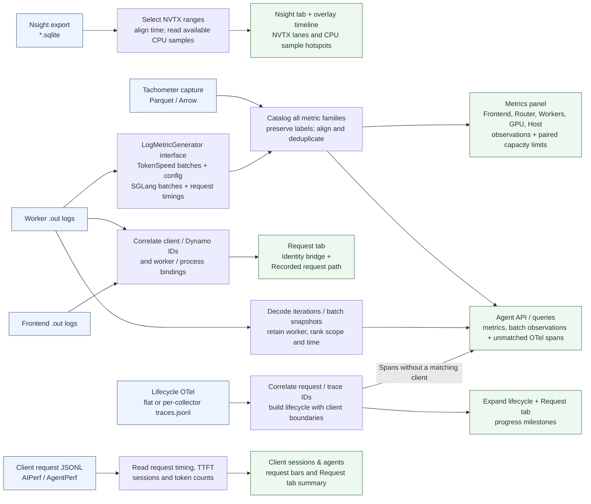
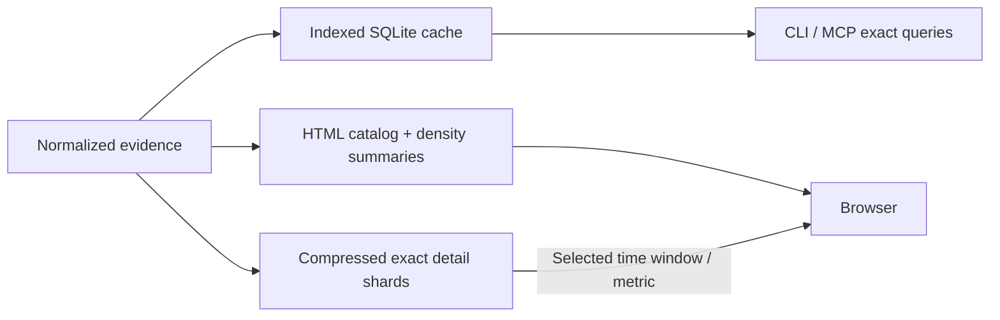
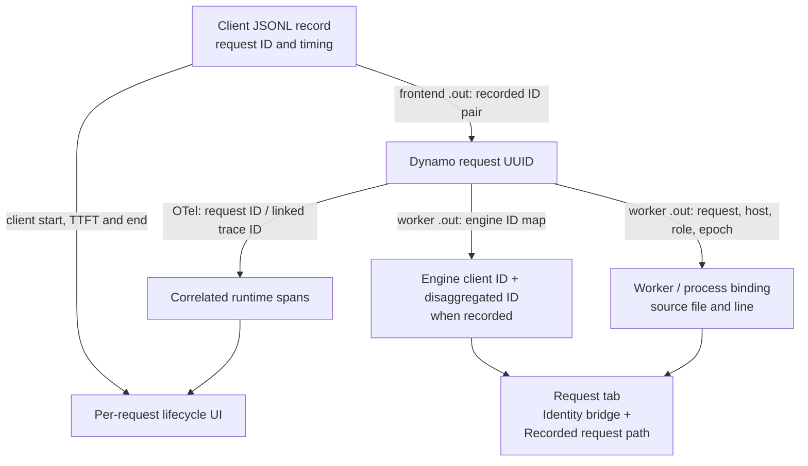

# DSight data flow: from captured files to UI

Use this page to answer: **Which file supplies this part of the dashboard, and
what happens to its data along the way?** See [DSight](dsight.md) for build
commands, input discovery and detailed timing definitions.

## Source files to visible views

The arrows below describe the current implementation. Blue boxes are saved
inputs; green boxes name their destinations in the UI. Each path shows what a
source contributes. The request-identity dependencies are expanded in the next
diagram.

The Python readers produce one normalized dataset containing requests, sessions,
workers, metrics, profiles, batch observations and unmatched OTel spans,
with references back to source files and rows. Log metric generators and Tachometer
share the metric series representation; log evidence does not need an intermediate
Parquet file. The [metric source/schema guide](dsight-log-metrics.md) documents the
raw columns, normalized points and capacity relationships. The builder writes a
versioned `trace-data.sqlite` cache and projects its normalized evidence into
compressed static detail shards. The HTML contains the request/lifecycle catalog,
profile and metric metadata, density bins, and shard indexes. The browser fetches
selected metric windows and exact Nsight ranges; CLI/MCP queries use SQLite's
indexes. Both preserve the existing source identities and time origin.

`--single-file` retains embedded HTML and the legacy JSON/gzip artifact.
Unmatched OTel spans remain queryable and exportable as
`server_spans`; they have no dedicated timeline section. The browser does not
open the original SQLite, Parquet or log files.

All views share a time origin: the first selected client request, or the earliest
recorded source timestamp when no client export is available. Nsight uses its
recorded UTC anchor; metric samples use their recorded epoch timestamps. Worker
logs need `--iteration-timezone` to align timestamps without an offset; their
recorded precision is retained. No cross-host clock correction is inferred.

The UI destinations use the current section and tab names:

| Visible area | What its data means |
| --- | --- |
| **Nsight** tab and overlay | NVTX intervals arranged by thread and overlap lane, alongside the selected request. Available frontend CPU samples feed **Frontend CPU sample hotspots**. CUDA kernel timing is not imported. |
| **Metrics** panel | Log-derived capacity families appear under Workers / Log-derived metrics, with paired dashed limits and per-source peak/usage summaries. A searchable selector groups every captured family into Frontend, Router, Workers, GPU and Host categories. Each family uses one shared chart across workers, hosts, ranks and labels; its legend controls individual series. Pinned families remain stacked while browsing other metrics, and all charts follow the shared time range. Families without samples in the selected capture window remain discoverable. |
| **Agent API / queries** | All imported metric series and bounded queries for independent server activity, batch observations and profiles, with source references and selection export. Batch observations retain recorded iteration or scheduler fields; missing counters and timers stay unknown. They are shared context, not per-request stage durations. |
| **Request** tab | Client measurements, recorded ID mappings and worker path. **Expand lifecycle** shows chronological progress milestones. Request-path cards open usable worker Nsight reports directly; cards without a report are disabled. |

The Nsight overlay is a time-based NVTX timeline. Its CPU hotspot table is a
separate view of samples, not an aggregate CPU flamegraph.

## Following one request across sources

The client export establishes the request and its timing. Frontend logs bridge
its HTTP request ID to the Dynamo UUID using text or JSON records. That UUID
connects to OTel spans and, independently, to worker/process bindings and any
engine-local IDs recorded in worker logs.

- **OTel supplies the existing request breakdown.** Supported spans retain their
  timestamps, parents and inclusive durations. Client start/first-token/end
  boundaries and server milestones produce the progress rows. An engine ID map
  is not required to construct these rows.
- **Worker bindings supply ownership and navigation.** Common Dynamo log fields
  associate a request with a recorded host, role and process epoch. The host and
  role must match the worker filename. Bindings retain the Dynamo attempt and
  their source/line, independently of engine-local IDs.
- **Engine ID maps supply additional identity.** TRT-LLM logs associate the
  Dynamo UUID with an engine client ID and disaggregated ID. These remain in
  `engine` and also supply a worker binding. Process scope comes from correlated
  spans when unambiguous; an unknown process remains unknown.
- **Span-to-worker association is explicit about its basis.** OTel joins to a
  matching request/process binding, or to the only discovered worker matching
  its recorded host and role. Collector directory names are not host evidence.
  Conflicting bindings remain in **Identity bridge**, request queries and selection
  exports but are omitted from the confirmed request path and worker filters.
- **Timing overlap supplies shared context.** A matching worker and overlapping
  Nsight range can be inspected beside a request; batch observations are available
  through queries and selection exports. That overlap does not assign the batch's
  execution cost to the request.

An ID pair alone contains no queue, compute or KV-transfer duration. The current
engine log decoders supply ID maps, iteration summaries and batch snapshots; they do not add
an engine-specific per-request breakdown beyond OTel.

## What the shared engine interface contributes

The engine interface centralizes vocabulary while the readers keep I/O, clocks,
correlation, source references and limits.

| Input to the engine interface | Answer returned to the reader |
| --- | --- |
| One worker-log line | Typed engine identity, iteration or scheduler-snapshot observations, or no recognized record. |
| One worker-log line + filename identity, through `LogMetricGenerator` | Timestamped metric values with rank/process/label scope. Metric definitions declare units, sample/event/setting semantics, and optional limit relationships. The shared reader owns alignment, evidence and exact-scope joins. Distinct request events preserve source-line identity even at the same timestamp. |
| An NVTX name and duration | Whether to include that host annotation and its engine/scope metadata. Original names and timestamps remain in the profile records. |
| A recorded metric name | Optional engine-specific display metadata and units. The shared Tachometer catalog includes other captured families too; values, labels and source rows remain in the metric reader. |

TRT-LLM currently supplies all three kinds of rules. SGLang and vLLM supply NVTX
names or prefixes and metric definitions; neither has a worker-log decoder here,
and both contribute worker-log metrics through a `LogMetricGenerator`. TokenSpeed supplies
NVTX vocabulary, metric definitions and periodic batch snapshots. Its
`DynamoTokenSpeedLogMetrics` generator also supplies active decode requests,
configured batch limits, active KV pages and usable page pool sizes to **Metrics**.
A dialect can
omit sources it cannot interpret.

## Worker metrics with Dynamo sidecars

When workers run with Dynamo sidecars, Tachometer scrapes up to two endpoints
per worker process. Both use the scraper's `backend` filter, which writes the
endpoint's `hostname`, `worker_index`, `worker_process` and `worker_role` as row
columns. DSight attributes both endpoints to the same `{role}-{index}` worker.
`scraper_endpoint` is part of each series identity, so the two endpoints never
merge, and a family's catalog entry lists only the endpoints that served it.

| Endpoint | Serves | vLLM | SGLang | TRT-LLM |
| --- | --- | --- | --- | --- |
| `backend_{mode}{index}_rank{rank}` | The sidecar's Dynamo system status server | Yes | Ranks that run a sidecar | Yes |
| `backend_{mode}{index}_rank{rank}_engine` | The engine's native Prometheus server | `vllm:*` families and the API server's `http_*` families | `sglang:*` families from every node | Not available |

What each endpoint contributes to **Metrics**:

- **Sidecar.** `dynamo_component_*` request, in-flight, duration, byte, error and
  cancellation series appear under Workers / Request lifecycle and First response
  and transport. Uptime and engine start, drain and cleanup times appear under
  Component lifecycle. `dynamo_work_handler_*` queue, permit and pool series appear
  under Admission and queues and Work-handler pool. vLLM and SGLang sidecars that
  relay KV events add `dynamo_component_kv_publisher_*` counters under Engine KV
  events. Sidecars publish no per-rank KV block or cache-usage gauges; those come
  from the engine endpoint.
- **vLLM engine.** Each data-parallel engine is a separate series with its
  `engine` label. That label is the engine's DP rank, so the series has rank kind
  `dp` and `--rank` selects one engine.
- **SGLang engine.** Each node publishes the scheduler series for its own ranks
  on its own endpoint, so a multi-node worker has one series per host. The
  `dp_rank` label sets rank kind `dp`; `tp_rank`, `pp_rank` and `moe_ep_rank` stay
  labels. Request histograms and token counters from SGLang's tokenizer carry an
  `is_streaming` label instead of scheduler ranks.
- **TRT-LLM engine.** In sidecar mode TRT-LLM serves its engine over OpenEngine
  gRPC, which starts no HTTP or Prometheus server (TRT-LLM `7695494b8f`,
  `tensorrt_llm/commands/serve.py`). A sidecar-mode capture therefore has no
  `trtllm_*` families. TRT-LLM iteration lines in worker logs, when recorded,
  remain the only source of engine iteration and KV utilization evidence.

Engine families share groups, units and titles by concept: running and queued
requests are under Engine scheduling, KV usage and prefix-cache counters under
Engine KV cache, SGLang's disaggregation queues and transfer histograms under
Engine KV transfer, and engine TTFT, inter-token latency, request lifetime and
per-request time per output token under Engine requests and latency. Engine
families without a catalog row stay under Workers / Other captured metrics with
their raw names. A router series' `dp_rank` names the worker it routes to, so
DSight does not use it as the router series' rank.

## Missing inputs

| Missing input | Current behavior |
| --- | --- |
| Client request export | Other sources can establish the time window. Client request bars and per-request breakdowns are absent; shared evidence remains available. |
| Frontend ID bridge | Requests retain client timing; correlation to Dynamo/engine IDs is unavailable. |
| Supported, correlated OTel | The affected request has no lifecycle expansion or milestone rows. Its client bar and TTFT remain. |
| Worker logs / engine ID maps | Log-based bindings, engine identities and iteration context are absent. OTel can still identify a unique discovered worker by its recorded host/role. |
| Nsight export or usable profile data | The Nsight section and controls are hidden. Missing CPU samples separately hide the hotspot table. |
| Tachometer capture | Metric charts and selectors are hidden. |
| Batch observations | Batch queries and selection exports contain no observations. |

Every source is optional. A build still needs a positive recorded time range.
Explicitly selected missing paths, malformed records and nonempty client exports
with no matching phase remain errors. An empty time selection keeps controls for
available sources; restored views cannot enable controls for missing evidence.
