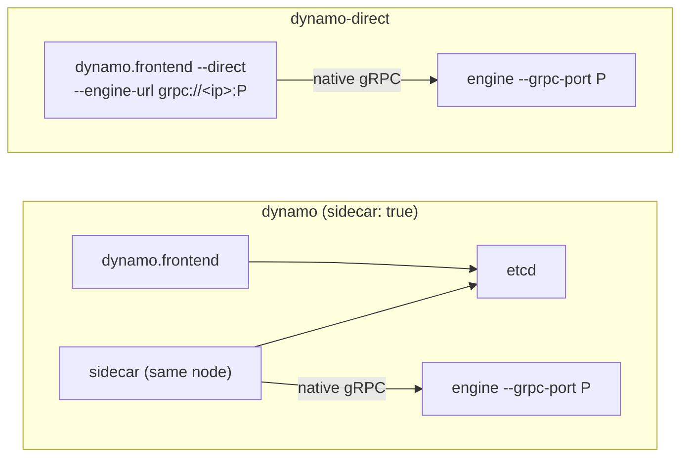

# Dynamo direct-to-engine

`frontend.type: dynamo-direct` runs the Dynamo frontend in `--direct` mode. The
frontend dials each engine's native gRPC API itself, so the engines are plain
`sglang.launch_server` processes: no `dynamo.sglang` worker, no Dynamo sidecar,
and no etcd or NATS. Routing, prefill/decode orchestration and migration run in
the frontend as they do for registered workers.



Only `engine: sglang` is supported, with SGLang's Rust server (v0.5.23 or later).

## What srtctl launches

| Process | Command |
| --- | --- |
| Each engine node | `python3 -m sglang.launch_server ... --port <http> --grpc-port <grpc> --incremental-streaming-output`, the same engine command as [sidecar mode](sidecars.md) without the sidecar |
| Frontend | `python3 -m dynamo.frontend --http-port=<port> --direct --direct-backend sglang --engine-url grpc://<ip>:<grpc> ...`, followed by `frontend.args` |

- One `--engine-url` is passed per node that hosts native gRPC listeners, in
  topology order. Each engine reports its own role (aggregated, prefill or
  decode), so the list is not split by role.
- The URL host is the worker node's address on the job's network interface. The
  frontend uses it as a prefill engine's KV bootstrap host.
- gRPC ports come from the allocator, starting at `dynamo.sidecar_port`.
- Worker environment defaults match sidecar mode: `SGLANG_RUST_SERVER=1` and
  `SGLANG_RUST_BUILD_MODE=never`. Set either in the role's `env` to override.
- `direct`, `direct-backend` and `engine-url` are managed; setting them in
  `frontend.args` is an error.
- Dynamo is installed in the frontend's container only (`dynamo.install`,
  `dynamo.source`). Workers do not install it.
- `frontend.router_policy_config`, `frontend.args` and `frontend.env` behave as
  for `frontend.type: dynamo`.

## Readiness and metrics

The frontend registers each dialed engine in its in-process discovery, so
`/health` lists them as it lists registered workers. srtctl waits for one
`generate` instance per `--engine-url`. An engine that is still loading is
probed again by the frontend with backoff, so the frontend starts without
waiting for the engines.

Tachometer and the benchmarks scrape each engine's `/metrics` on its own HTTP
port and the frontend's on the public port.

## Example

[`examples/sglang/dynamo-direct-disagg.yaml`](https://github.com/NVIDIA/srt-slurm/blob/main/examples/sglang/dynamo-direct-disagg.yaml):

```yaml
dynamo:
  source:
    git: https://github.com/ai-dynamo/dynamo
    rev: 3e2af8eefe56b15baa985384590e0d723112058c   # ai-dynamo/dynamo#19568, which adds --direct

frontend:
  type: dynamo-direct
  enable_multiple_frontends: false
  args:
    router-mode: "kv"

engine: sglang
```

## Limitations

- Each frontend replica keeps its own discovery and router state. Run one
  frontend (`enable_multiple_frontends: false`) when routing depends on shared
  state.
- `dynamo.sidecar: true` and `engine.failover` require `frontend.type: dynamo`.
