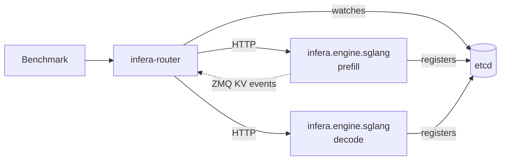

# Infera Router

`frontend.type: infera` fronts SGLang workers with [Infera](https://github.com/AMD-AGI/Infera)'s
`infera-router`. Workers register themselves in the job's etcd and the router discovers them
there, so this is a dynamic frontend like Dynamo; each worker is still SGLang's own OpenAI
server, so the engine flags are the ones `sglang.launch_server` receives under any direct
frontend. Recipe: [SGLang P/D with the Infera router](https://github.com/NVIDIA/srt-slurm/blob/main/examples/sglang/infera-disagg.yaml).

## Requirements

- `engine: sglang`. Configuration loading rejects other engines.
- Infera installed in the worker and router containers. The stock SGLang image does not ship it;
  `setup_script: install-infera.sh` installs the release named by `INFERA_VERSION` from Infera's
  GitHub release, without touching the image's packages. Use a release whose worker launcher
  advertises the KV-events endpoint passed in `--kv-events-config` (amd-infera 0.3.2 or later).

## What srtctl sets

| Piece | Behavior |
| --- | --- |
| Discovery | etcd is implied on the infra node; NATS is not, because requests and KV events go over HTTP and ZMQ. An `external` etcd service is rejected. |
| Workers | `python3 -m infera.engine.sglang --discovery-backend etcd --etcd-endpoint http://<infra>:2379 --advertise-host <node IP> --request-transport http --kv-event-transport zmq --kv-events off`, followed by the SGLang flags srtctl builds for a direct worker: allocated HTTP port, disaggregation mode and bootstrap port, `--enable-metrics`, multi-node coordination and `roles.<role>.args`. |
| KV events | `roles.<role>.kv_events` gives that role an allocated publisher port block (one port per DP rank) in `--kv-events-config`; the worker registers it and the router subscribes directly. A role without `kv_events` registers with `--no-enable-kv-events`. Infera's own KV probe plane, which `infera-router` does not read, is off. |
| Router | `python3 -m infera.server --router-backend rust --host 0.0.0.0 --port <frontend port> --discovery-backend etcd --etcd-endpoint ... --request-transport http --kv-event-transport zmq`, then `frontend.args`. Infera's launcher resolves a Hugging Face id to a local tokenizer and execs `infera-router`. srtctl owns `router-backend`, `host`, `port`, `discovery-backend`, `etcd-endpoint`, `request-transport` and `kv-event-transport`; setting any of them in `frontend.args` is rejected. `router-tokenizer-path` defaults to the checkpoint the workers load (`/model`, or the Hugging Face id). |
| Readiness | The router's `/v1/workers` lists registrations with their role and status; the job is ready when the active prefill and decode registrations reach the topology's counts (an aggregate worker counts as decode). |
| Metrics | Each worker's leader rank serves SGLang's `/metrics` on its HTTP port. |

Router policy and tuning (`router-policy`, `kv-prefill-overlap-weight`, `session-affinity`,
`decode-request-weight`, ...) come from `frontend.args`, under the flag names of
`python3 -m infera.server`. `frontend.container_image` overrides the router's image; it defaults to
`model.container`.
