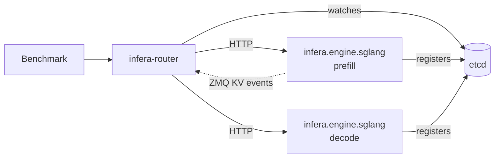

# Infera Router

`frontend.type: infera` fronts SGLang workers with [Infera](https://github.com/AMD-AGI/Infera)'s
`infera-router`. Workers register themselves in the job's etcd and the router discovers them
there, so this is a dynamic frontend like Dynamo; each worker is still SGLang's own OpenAI
server, so the engine flags are the ones `sglang.launch_server` receives under any direct
frontend. Recipe: [SGLang P/D with the Infera router](https://github.com/NVIDIA/srt-slurm/blob/main/examples/sglang/infera-disagg.yaml).

## Requirements

- `engine: sglang`. Configuration loading rejects other engines.
- Infera installed in the worker and router containers. The stock SGLang image does not ship it;
  `setup_script: install-infera.sh` installs the release named by `INFERA_VERSION` from PyPI
  (`amd-infera`), without touching the image's packages. Use a release whose Linux x86_64 wheel
  bundles `infera-router` (AMD-AGI/Infera#223) and whose worker launcher advertises the KV-events
  endpoint passed in `--kv-events-config` (AMD-AGI/Infera#222); the script fails on a release
  without the bundled router.
- One Infera release for the router and every worker. They agree because they all read
  `INFERA_VERSION`; configuration loading rejects a recipe whose `environment`, `frontend.env` and
  `roles.<role>.env` set different values. srtctl also relies on that release's launcher passing
  every flag it does not know on to SGLang unchanged, so validate a new release on hardware before
  moving the pin.

## What srtctl sets

| Piece | Behavior |
| --- | --- |
| Discovery | etcd is implied on the infra node; NATS is not, because requests and KV events go over HTTP and ZMQ. An `external` etcd service is rejected. |
| Workers | `python3 -m infera.engine.sglang --discovery-backend etcd --etcd-endpoint http://<infra>:2379 --advertise-host <node IP> --request-transport http --kv-event-transport zmq --kv-events off`, followed by the SGLang flags srtctl builds for a direct worker: allocated HTTP port, disaggregation mode and bootstrap port, `--enable-metrics`, multi-node coordination and `roles.<role>.args`. Every listener the launcher opens is allocated: the readiness port it opens once registered is the process's system port (unused otherwise without Dynamo), set as `INFERA_READINESS_PORT` in the worker environment, where the recipe's `environment` can override it. A role with `grpc-mode` is rejected: the router routes over HTTP, and the launcher registers a worker only once SGLang's HTTP `/health` answers. |
| KV-cache dtype | Infera's launcher sets SGLang's KV cache to `fp8_e4m3` whenever the command line has no `--kv-cache-dtype`. srtctl sets `INFERA_DEFAULT_KV_FP8=0` in the worker environment, so the dtype is the recipe's, as under any other frontend: set `kv-cache-dtype` in `roles.<role>.args` for fp8. The recipe's `environment` can override the variable. |
| KV events | `roles.<role>.kv_events` gives that role an allocated publisher port block (one port per DP rank) in `--kv-events-config`; the worker registers it and the router subscribes directly. A role without `kv_events` gets `--no-enable-kv-events`; without it the launcher would publish on a port of its own. `router-policy: kv-aware`, `infera.server`'s default, routes on these events, so configuration loading rejects it when no role publishes them, unless `decode-input-demand` (`frontend.args` or `INFERA_DECODE_INPUT_DEMAND`) is `on` or `shadow`: that decode balancing runs only under kv-aware and needs no events, so loading warns instead. Infera's own KV probe plane, which `infera-router` does not read, is off. |
| Router | `python3 -m infera.server --router-backend rust --host 0.0.0.0 --port <frontend port> --discovery-backend etcd --etcd-endpoint ... --request-transport http --kv-event-transport zmq`, then `frontend.args`. Infera's launcher resolves a Hugging Face id to a local tokenizer and execs `infera-router`. srtctl owns `router-backend`, `host`, `port`, `discovery-backend`, `etcd-endpoint`, `request-transport` and `kv-event-transport`; setting any of them in `frontend.args` is rejected. `router-tokenizer-path` defaults to the checkpoint the workers load (`/model`, or the Hugging Face id). |
| Readiness | The router's `/v1/workers` lists registrations with their role and status; the job is ready when the active prefill and decode registrations reach the topology's counts (an aggregate worker counts as decode). The launcher registers a worker only after SGLang's `/health` answers, so a registration means the server is serving. An entry without `status` or `disagg_mode` does not count. |
| Metrics | Each worker's leader rank serves SGLang's `/metrics` on its HTTP port. |

Router policy and tuning (`router-policy`, `kv-prefill-overlap-weight`, `session-affinity`,
`decode-request-weight`, ...) come from `frontend.args`, under the flag names of
`python3 -m infera.server`. `frontend.container_image` overrides the router's image; it defaults to
`model.container`.

## What the roles must agree on

- Served model name: the router pools workers by the model name they register and routes a
  request to the pools of the model it names. srtctl passes every role one `--served-model-name`
  (the first of prefill, agg, decode that sets it, else the checkpoint's name), so prefill and
  decode always pair.
- Page size: each worker registers the page size SGLang resolved, and the router builds that
  worker's KV view in blocks of that size, so nothing on the router side has to match. Prefill and
  decode still need the same `page-size` for SGLang's own KV transfer.

## Engines

SGLang only. Infera also wraps vLLM (`infera.engine.vllm`), but supporting it takes more than a
row in `WORKER_LAUNCHERS`: the vLLM backend would have to call the frontend's worker hooks, and the
port answers (metrics, endpoint, profiling on the leader's HTTP port) would need checking against
vLLM's layout.
