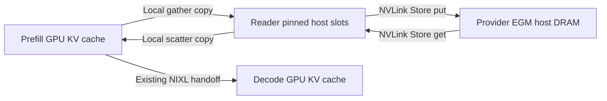

# GLM-5.3 AgentX Pareto recipes with Dynamo on Vera Rubin

These eight baseline recipes are Dynamo counterparts of
[`../trtllm-serve`](../trtllm-serve/README.md). They launch `dynamo.trtllm`
prefill/decode workers behind `dynamo.frontend`, with Dynamo installed from
the local wheels in `/home/rihuo/dynamo_wheels`.
Filenames and point names match the native recipes.
Additional [EGM variants](#egm-over-nvlink) use Mooncake Store over NVLink.

The conversion keeps the worker counts, GPU allocations, TRT-LLM engine tuning,
kernel environment, MTP acceptance controls, prefill Mooncake capacity
and inline AIPerf command. The native recipes remain in their original directory.

All recipes set `engine.numa_memory_bind: local` and `engine.numa_cpu_bind: true`
to bind worker memory and CPUs to the task GPU's NUMA node.

| Recipe | Prefill workers / GPUs each | Decode workers / GPUs each | Concurrency | Prefill affinity | Decode affinity |
| --- | --- | --- | --- | --- | --- |
| [1p1d / tp16](glm5.3-disagg-1p1d-tp4-tp16-c1.yaml) | 1 / 4 | 1 / 16 | 1 | session | none |
| [1p2d / tp4](glm5.3-disagg-1p2d-tp4-tp4-c36.yaml) | 1 / 4 | 2 / 4 | 36 | session | none |
| [1p3d / tp8](glm5.3-disagg-1p3d-tp4-tp8-c40.yaml) | 1 / 4 | 3 / 8 | 40 | session | none |
| [1p3d / tp4](glm5.3-disagg-1p3d-tp4-tp4-c64.yaml) | 1 / 4 | 3 / 4 | 64 | session | none |
| [3p1d / dep32](glm5.3-disagg-3p1d-tp4-dep32-c560.yaml) | 3 / 4 | 1 / 32 | 560 | none | none |
| [3p1d / dep16 / c640](glm5.3-disagg-3p1d-tp4-dep16-c640.yaml) | 3 / 4 | 1 / 16 | 640 | none | none |
| [3p1d / dep16 / c576](glm5.3-disagg-3p1d-tp4-dep16-c576.yaml) | 3 / 4 | 1 / 16 | 576 | none | none |
| [3p1d / dep8](glm5.3-disagg-3p1d-tp4-dep8-c560.yaml) | 3 / 4 | 1 / 8 | 560 | none | session |

## Dynamo installation and cluster settings

Every recipe mounts `/home/rihuo/dynamo_wheels` at `/dynamo_wheels` and runs
[`configs/install_dynamo_wheel.sh`](../../../../../configs/install_dynamo_wheel.sh)
before starting workers and the frontend. The script installs the local wheels
and their dependencies. The built-in Dynamo installer is disabled so it does
not replace those wheels:

```yaml
setup_script: install_dynamo_wheel.sh
dynamo:
  install: false
  request_plane: tcp
  event_plane: zmq
```

The recipes use these model and image paths directly:

```yaml
model:
  path: /home/rihuo/GLM-5.3-NVFP4
  container: /home/_shared/tensorrt-llm-release-arm64-f1bdd25-user_imant_glm5-rubin-30428.sqsh
```

Set the cluster GPU count and allocation policy in `srtslurm.yaml`:

```yaml
gpus_per_node: 4
use_segment_sbatch_directive: true
```

The image must support the Rubin kernels, MTP prefill, Python NIXL transceiver
and Mooncake donor. Installing the base Dynamo packages leaves this custom
TRT-LLM build in place; do not install
`ai-dynamo[trtllm]`, which pins a different TRT-LLM release.

srt-slurm supplies etcd discovery, TCP request transport and ZMQ events. These
recipes do not require a NATS service.
Keep the site's account, partition, network interface, cache mounts and other
cluster settings in `srtslurm.yaml`. As with the native recipes, the full
allocation must fit within one NVL72 domain.

Their top-level `environment` sets `PIP_CONFIG_FILE=/dev/null`,
`PIP_INDEX_URL=https://pypi.org/simple` and
`PIP_EXTRA_INDEX_URL=https://pypi.nvidia.com`. This overrides the image's
`/etc/environment` pip index at `urm.nvidia.com`, which RapLab cannot resolve.

```bash
srtctl dry-run -f recipes/trtllm/vrnvl72/agentic/raplab-dynamo/glm5.3-disagg-3p1d-tp4-dep8-c560.yaml
```

## Routing and parsing

All eight recipes run a single frontend on a dedicated node,
with the benchmark client colocated on that same node. Both set
`placement.node: dedicated`; `benchmark.colocate_with_frontend` defaults to
`true`, so they share one extra node. In the four recipes without Mooncake,
the frontend uses `router-mode: kv` and a 14,400-second session-affinity TTL.
Prefill workers inherit that frontend policy. Decode workers advertise
`DYN_ROUTER_MODE=least-loaded`, without session affinity, overriding the frontend
policy for the decode tier. The existing AIPerf session-ID headers are retained.

These frontends use an etcd lease TTL of 120 seconds, the `fastokens` tokenizer,
an 8,000,000,000-byte tokenizer cache budget, and a 30-second TCP request timeout.
`DYN_ROUTER_USE_KV_EVENTS=0` is this Dynamo version's supported switch for routing
without worker KV events. All eight recipes disable the implicit `otel-collector`
service and set `observability.enable_otel: false`.
Default temperature, cache enablement, JSONL and
unset admission thresholds are omitted, as is the TCP request-plane setting
that srt-slurm already injects.

The four Mooncake recipes keep their existing frontend and worker policies:
`router-mode: least-loaded`, with 3,600-second hard session affinity only on
roles corresponding to the native recipes' `conversation` policy.

Worker roles using session affinity set `DYN_ENGINE_CONV_AFFINITY=1`: prefill
in the four recipes without Mooncake, and decode in the DEP8 Mooncake recipe.
This enables the corresponding TRT-LLM engine conversation-affinity handling.

`DYN_TOOL_CALL_PARSER=glm47` on both worker roles advertises the parser in their
model cards for Dynamo's Rust chat processor. Native `--tool_parser` arguments
are removed. Dynamo reads the KV block size from the initialized engine;
`kv_cache_config.tokens_per_block` remains the source of truth. Both roles set
`enable_iter_perf_stats: true`, `iter_perf_stats_interval: 40` and
`kv_cache_config.iteration_stats_interval: 40`. Engine-level `return_perf_metrics`
is retained from the native recipes; the native frontend's `server_config_extra` settings are
replaced by Dynamo's frontend configuration. `num_postprocess_workers` is
removed because this Dynamo version strips that setting and owns postprocessing.

These options were originally checked against the published `ai-dynamo` wheel's
`dynamo/common/configuration/groups/router_args.py`, `runtime_args.py`, and
`dynamo/trtllm/workers/llm_worker.py` at `1.6.0.dev20261013`. Local wheels must
support these options.

## Mooncake and workload

The four TP decode recipes retain private prefill host caches. The four DEP
recipes retain their Mooncake master and one `trtllm-serve mooncake_donor` per
decode node. All donors within a recipe use its largest original segment size;
the dedicated frontend/client node frees the memory previously reserved on the
first decode node:

| Decode topology | Donor segment size per decode node |
| --- | --- |
| DEP32 | 768GiB |
| DEP16 (c576 and c640) | 1050GiB |
| DEP8 | 1100GiB |

The image's Mooncake Python store wheel is pinned to 0.3.13. With RDMA, it
[discovers NIC NUMA nodes and splits the segment across them](https://github.com/kvcache-ai/Mooncake/blob/v0.3.13/mooncake-store/src/real_client.cpp#L886),
then [binds each memory region to its NUMA node](https://github.com/kvcache-ai/Mooncake/blob/v0.3.13/mooncake-store/src/utils.cpp#L378).
The donor keeps the complete NIC allowlist and relies on that allocation policy.
This does not impose per-NUMA process CPU binding.

Decode workers remain connector-free; prefill workers receive
`MOONCAKE_CONFIG_PATH` and use the
shared store. The donor remains a separate capacity process even though the
inference workers now use Dynamo. Prefill workers and donors both set
`MC_ENABLE_PARALLEL_REG_MR=0`, `MC_MS_AUTO_DISC=0`,
`MC_TE_FILTERS=mlx5_0,mlx5_1,mlx5_2,mlx5_5,mlx5_6,mlx5_7,mlx5_8,mlx5_11` and
`MC_ENABLE_DEST_DEVICE_AFFINITY=1` in their process environments so Mooncake's
in-process transport receives them. The donor also sets `TLLM_LOG_LEVEL=INFO`
and `PYTHONUNBUFFERED=1` for logging; inference tuning stays in the worker
environments. Other store settings come from the config and CLI.

The master starts before workers. Donors use `start: after_frontend`: Dynamo's
worker and frontend launches return before model readiness, allowing donor
registration to overlap worker loading. Donors publish
`/logs/mooncake_donor_{index}.ready`; the `readiness.file` gate waits for them
before benchmarking. Donors now share the workers' shutdown tier, while the
master shuts down afterward. This requires srt-slurm's
[file-readiness support](https://github.com/NVIDIA/srt-slurm/pull/608).
See the [native Mooncake notes](../trtllm-serve/README.md#mooncake) for prefill
segment sizes and other inherited pool settings.

Each recipe mounts `/home/rihuo/:/home/rihuo/`. The benchmark installs AIPerf
from `/home/rihuo/agentx-harness` in a temporary environment and invokes
`aiperf profile` directly against the discovered frontend. The AgentX scenario,
dataset, concurrency, session headers, warmup and 3,600-second measurement are
unchanged. Results remain under `/logs/agentic/aiperf_results`.

All eight benchmarks set `AIPERF_UI_REALTIME_METRICS_ENABLED=true` so AIPerf
prints real-time stats to the benchmark log without an interactive terminal.
The existing `--stats-interval 30` emits updates every 30 seconds when measured
request results or server metrics change.

The benchmark client passes the runtime-provided `AIPERF_SERVER_METRICS_URLS`
list to `aiperf profile --server-metrics`, collecting each logical prefill and
decode worker's `/metrics` endpoint on its `DYN_SYSTEM_PORT`. Worker metrics
publication is enabled by default. The command requires that endpoint list
and exports JSON, CSV, Parquet and JSONL under the same artifact directory;
JSONL retains individual scrape snapshots, with `endpoint_url` identifying the
worker. See the [custom benchmark endpoint variables](../../../../../docs/benchmarks.md#custom).

For every actual cluster run, write `<run_dir>/logs/perf-analysis.md` following
[`docs/perf-analysis.md`](../../../../../docs/perf-analysis.md).

## EGM over NVLink

[`glm5.3-disagg-3p1d-tp4-dep8-c560-egm.yaml`](glm5.3-disagg-3p1d-tp4-dep8-c560-egm.yaml)
is an experimental variant of the RapLab DEP8 c560 recipe. The original
[`../dynamo` recipe](../dynamo/glm5.3-disagg-3p1d-tp4-dep8-c560.yaml) contributes
`5120GiB` nominal capacity (`3 × 4 × 260 + 2 × 1000`). This variant preserves
the RapLab baseline's `5320GiB` pool: each of three prefill providers contributes
`1040GiB`, replacing four `260GiB` rank pools, and each of two decode providers
contributes `1100GiB`.

### TRT-LLM integration and transport choice

The connector path was checked against tekit commit
`7890925ea10e613cd787c82a406a8fdc088eabc8`, in
`tensorrt_llm/_torch/pyexecutor/connectors/mooncake_store/`:

- `config.py` reads `MOONCAKE_CONFIG_PATH`; `worker.py::_open_store` forwards
  the selected protocol, capacity and master address to the Python Store's
  positional `setup` API. The master coordinates the pool; providers own its
  memory.
- `worker.py::register_kv_cache_layout` opens `staging.py::HostStagingPool`
  when `stage_through_host` is true. The pool registers pinned CPU slots with
  Store. Local CUDA copies gather active GPU KV into those slots before a
  write and scatter it back after a read. This variant uses that path, so
  Mooncake receives host pointers rather than GPU KV addresses.
- `donor.py::donate_segment` and `trtllm-serve mooncake_donor` use positional
  setup without EGM allocation options. Setting their protocol to `nvlink`
  does not turn an ordinary host pool into exportable EGM memory. The dedicated
  native providers below use the dictionary setup API to request that memory.

EGM supplies Fabric-exportable host DRAM. This is the Mooncake Store data path
in the variant:



Both Mooncake payload endpoints use host memory: pinned slots on the reader
and Fabric-exportable HOST_NUMA DRAM on the provider. Classic NVLink accepts
local pinned host initiators and submits their pointers directly to CUDA
batched copies; it does not need a separate GPU payload staging buffer or a
TENT build. GPUs still supply CUDA contexts, streams and copy submission.
Active inference KV remains in GPU memory. UCX/NIXL settings control other
communication paths; they do not select the Mooncake Store transport.
This was checked in Mooncake `042ab8a18b0e`: its
[`NvlinkTransport::registerLocalMemory`](https://github.com/kvcache-ai/Mooncake/blob/042ab8a18b0e6ccfe87782261a5556a3dd4446e4/mooncake-transfer-engine/src/transport/nvlink_transport/nvlink_transport.cpp#L1035)
accepts local buffers without exportable VMM handles; only the provider pool
needs Fabric export. The recipe retains the classic transport required by
native EGM Store setup.

### Required Mooncake build

The recipe requires an ARM64 CUDA 13
Mooncake wheel built from commit
[`db195f7f7cad61a0a3c3141b8ecf6ca399a54fca`](https://github.com/kvcache-ai/Mooncake/commit/db195f7f7cad61a0a3c3141b8ecf6ca399a54fca)
or its upstream squash `9c0528d9` containing the merged EGM stack, with
`WITH_STORE=ON`, `USE_CUDA=ON`, `USE_MNNVL=ON` and `USE_VRAM_SEGMENT=OFF`
(the upstream default). The image's published `0.3.13` wheel lacks
this feature. The upstream changes are
[EGM Store pooling](https://github.com/kvcache-ai/Mooncake/pull/3335) and
[direct remote GPU reads](https://github.com/kvcache-ai/Mooncake/pull/3431).
This pins a combined stack: tekit uses `batch_get_into_multi_buffers`, whose
memory-replica path forwards the supplied host destinations directly; the
latter change also removes remote-read staging in other Store read APIs.
The install check verifies the native EGM API rather than the exact source
revision or build flags; use the specified build to reproduce this
configuration. The upstream ARM64 CUDA 13 nightly profile leaves
`USE_VRAM_SEGMENT=OFF`, keeping ordinary Store local buffers in host memory.
See the [wheel build profile](https://github.com/kvcache-ai/Mooncake/blob/042ab8a18b0e6ccfe87782261a5556a3dd4446e4/.github/workflows/_build-wheel.yaml)
and the [default build options](https://github.com/kvcache-ai/Mooncake/blob/042ab8a18b0e6ccfe87782261a5556a3dd4446e4/docs/source/getting_started/build.md).

Place exactly one matching wheel in `/home/rihuo/mooncake_egm_wheels/`, which is
already covered by the recipe's home-directory mount. To change the directory,
update `SRT_MOONCAKE_EGM_WHEEL_DIR` in the recipe's global environment and all
three Mooncake service environments. Alternatively, use an image that already
contains a compatible build. `setup_mooncake_egm.sh` keeps the existing Dynamo
wheel installation, installs the supplied Mooncake wheel without replacing the
image's other dependencies, and checks the native EGM API. Each master/provider
container runs its own Mooncake setup. The master launches through
`python3 -m mooncake.cli`, using the binary from the installed wheel.

The cache path changes as follows:

- Prefill ranks use `protocol: nvlink`, zero ordinary Store capacity and
  `stage_through_host: true`, with `staging_buffer_bytes: 2GiB`, passing pinned
  host slots to Store.
  Their `64MiB` local buffer satisfies this TRT-LLM connector's positive-size
  validation and is host memory with `USE_VRAM_SEGMENT=OFF`; it is separate
  from the connector's pinned staging slots.
- One EGM provider per prefill node contributes `1040GiB`, replacing the four
  ordinary `260GiB` rank pools. Each decode-node provider contributes `1100GiB`.
  Total nominal capacity remains `3 × 1040 + 2 × 1100 = 5320GiB`, subject to
  native allocation alignment. Providers call the dictionary setup API with
  `enable_egm_store_pool=true`, `egm_numa_nodes=auto`, and a zero local buffer.
- Providers expose all four GPUs so automatic discovery includes both host
  NUMA nodes. They start before clients and stop after clients; the master
  remains available until providers finish cleanup.
- Mooncake uses explicit classic NVLink transport. Its RDMA device filters and
  destination affinity settings are removed. The existing NIXL handoff between
  prefill and decode, model tuning, concurrency, benchmark duration, metrics and
  disabled OTEL settings are retained.

The allocation requests six exclusive nodes, all allocatable memory and
`--segment=6`. The six-node count includes the shared frontend/client node.
Participating GPUs must have supported HOST_NUMA/Fabric allocation, accessible
IMEX channels, and membership in one NVLink fabric domain. A Slurm segment is an
allocation constraint; it does not replace checking fabric membership/health.
Unset `MC_USE_NVLINK_IPC` before launching: even its value `0` selects IPC rather
than Fabric mode. Setup rejects that setting and unsupported Store builds;
provider allocation errors are fatal, without an RDMA fallback.

The two-hour allocation follows the job-sizing fallback for the retained
60-minute load point, existing warmup, startup and drain; there is no comparable
EGM serving history yet. Validate the resolved launch before submitting:

```bash
srtctl dry-run -f recipes/trtllm/vrnvl72/agentic/raplab-dynamo/glm5.3-disagg-3p1d-tp4-dep8-c560-egm.yaml
```

Compare TTFT percentiles, cache hits and async-load diagnostics with the RDMA
baseline at the same workload. Provider ready files and logs record the NVLink
configuration and allocated EGM capacity. This experiment changes the
transport and pool allocation while retaining host staging. Local schema,
mock and unit checks do not establish hardware compatibility or performance.

### Four prefill providers per node

[`glm5.3-disagg-3p1d-tp4-dep8-c560-egm-4x260.yaml`](glm5.3-disagg-3p1d-tp4-dep8-c560-egm-4x260.yaml)
adapts the [Dynamo four-provider recipe](../dynamo/glm5.3-disagg-3p1d-tp4-dep8-c560-egm-4x260.yaml)
to RapLab's model/image paths, wheel directories, caches, pip and UCX/MPI/NCCL
settings. It starts four separate `260GiB` EGM providers on
each prefill node, with this placement:

| Prefill donor | `CUDA_VISIBLE_DEVICES` | Host NUMA node | Pool capacity |
| --- | --- | --- | --- |
| `prefill-egm-donor-0` | `0` | `0` | `260GiB` |
| `prefill-egm-donor-1` | `1` | `0` | `260GiB` |
| `prefill-egm-donor-2` | `2` | `1` | `260GiB` |
| `prefill-egm-donor-3` | `3` | `1` | `260GiB` |

Each provider sees one physical GPU, numbered as CUDA device 0 in its process,
and allocates its whole pool on the explicit `--numa-nodes` host node. The mapping
assumes GPUs 0/1 are attached to host NUMA 0 and GPUs 2/3 to host NUMA 1; check
the topology before using this mapping on another system. Readers independently
import the exported Fabric allocations. All pools remain shared; the GPU masks
and NUMA settings do not create exclusive reader-to-donor assignments.

The three prefill nodes contribute 12 owners and `3120GiB`; the two decode
providers retain `1100GiB` each, all four visible GPUs and NUMA `auto`. Total
capacity is `5320GiB` across 14 owners, matching the RapLab baseline. Each provider
publishes its own readiness file, and all providers become ready before inference
workers start. The master remains available until provider cleanup completes.

This variant retains the single-provider RapLab recipe's host-only Mooncake
payloads, inference NUMA CPU/local memory binding, engine tuning and complete
AgentX workload. It uses `/home/rihuo/mooncake_egm_wheels` with the build requirements
above. If that path changes, update the global environment and all six Mooncake
service environments. RapLab's pip overrides are present in each service.
The topology requires six nodes and retains the 60-minute measurement. Its
`sbatch_directives` request exclusive nodes and all allocatable host memory
(`mem: '0'`). NVLink segment sizing, account, partition and walltime follow
cluster defaults and submission overrides; this recipe has no `slurm` block.

```bash
srtctl dry-run -f recipes/trtllm/vrnvl72/agentic/raplab-dynamo/glm5.3-disagg-3p1d-tp4-dep8-c560-egm-4x260.yaml
```
